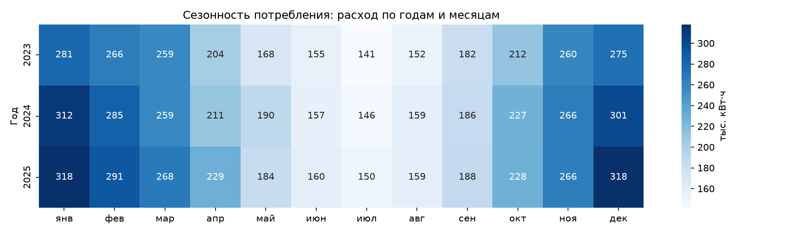
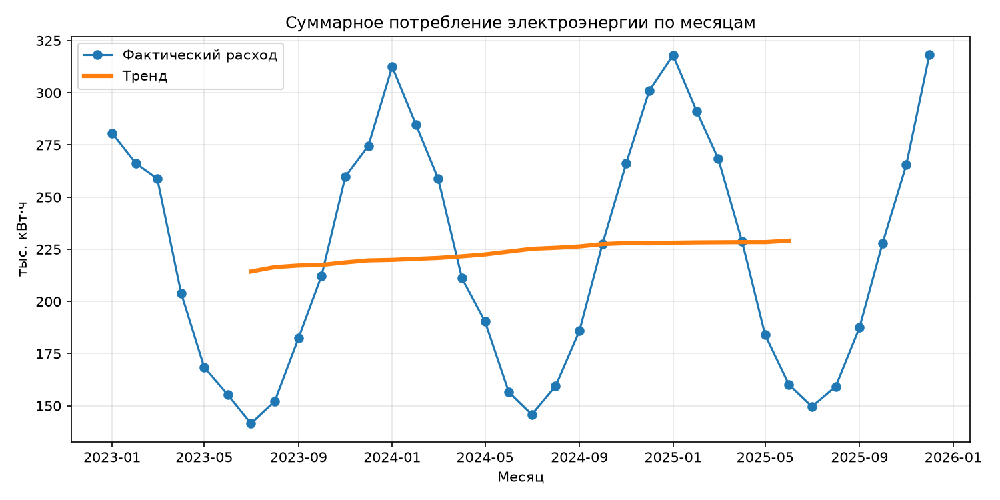

# Автоматизация обработки данных: потребление электроэнергии

Python-конвейер, который автоматически загружает данные о потреблении электроэнергии
из разных источников, проверяет и очищает их, проводит анализ, строит модель прогноза
расхода, формирует отчёты (PDF, Excel, графики), рассылает их по email и сохраняет
результаты в PostgreSQL. Запускается по расписанию; результаты доступны через REST API.

Предметная область — энергосбыт: абоненты (физические и юридические лица) и их
помесячный расход электроэнергии за 2023–2025 годы.

## Возможности

| Этап | Что делается | Модуль |
|---|---|---|
| Загрузка | CSV, Excel, PostgreSQL (SQL с JOIN и агрегатами), REST API (архив погоды Open-Meteo) | `loader.py` |
| Валидация | Дубликаты, пропуски, типы данных, выбросы (IQR, Z-score), логирование результатов | `validator.py` |
| Очистка | Удаление дубликатов, даты в datetime, заполнение пропусков (среднее / медиана / удаление и по правилам расчёта), Label и One-Hot Encoding, масштабирование | `cleaner.py` |
| Анализ | Среднее, медиана, мода, стандартное отклонение; декомпозиция временного ряда (тренд, сезонность); поиск аномальных месяцев; модели регрессии и метрики MAE, RMSE, R² | `analyzer.py` |
| Отчёты | Графики Matplotlib, Seaborn, Plotly; отчёты PDF (ReportLab) и Excel (openpyxl); отправка по email (SMTP) | `reporter.py` |
| Хранение | Сохранение результатов анализа и лучшей модели в PostgreSQL | `storage.py` |
| Интеграция | REST API (FastAPI) для BI-систем: результаты и прогноз | `api.py` |
| Автоматизация | Полный конвейер одной командой, журнал в файл с ротацией, запуск по расписанию | `main.py`, `run_pipeline.bat` |

## Быстрый старт

Требования: Python 3.11+, Docker Desktop.

```bash
# 1. Клонировать репозиторий и создать окружение
git clone https://github.com/ValentinaNVV/data_pipeline.git
cd data_pipeline
python -m venv venv
venv\Scripts\activate            # Windows
# source venv/bin/activate       # Linux / macOS
python -m pip install -r requirements.txt

# 2. Настройки: скопировать пример и при необходимости заполнить почту
copy .env.example .env           # Windows
# cp .env.example .env           # Linux / macOS

# 3. Поднять PostgreSQL и залить данные
docker compose up -d
python init_db.py

# 4. Запустить конвейер
python main.py
```

Результаты появятся в папке `reports/`, журнал — в `logs/pipeline.log`.
Учебные данные уже лежат в `data/`; пересоздать их можно командой `python generate_data.py`.

## Настройки (`.env`)

| Переменная | Назначение |
|---|---|
| `DB_HOST`, `DB_PORT`, `DB_NAME`, `DB_USER`, `DB_PASSWORD` | Подключение к PostgreSQL (порт 5433, см. `docker-compose.yml`) |
| `SMTP_HOST`, `SMTP_PORT` | Почтовый сервер (для Mail.ru: `smtp.mail.ru`, `465`) |
| `SMTP_USER`, `SMTP_PASSWORD` | Адрес отправителя и пароль для внешнего приложения |
| `REPORT_RECIPIENTS` | Получатели отчёта через запятую |

Если почта не настроена, отправка пропускается с предупреждением в журнале — остальные этапы работают.
Для безопасности пароль приложения стоит создавать с минимальными правами («только отправка писем», SMTP).

## Данные

| Файл / таблица | Содержимое |
|---|---|
| `data/customers.xlsx` → `customers` | Справочник абонентов: `customer_id`, `account_number`, `district`, `tariff`, `customer_type` |
| `data/consumption.csv` → `consumption` | Расход по месяцам: `customer_id`, `period` (ДД.ММ.ГГГГ), `kwh` |
| Open-Meteo API | Средняя дневная температура воздуха |

В данные намеренно внесены ошибки для проверки валидации и очистки:
20 дубликатов, 50 пропусков, 10 выбросов (расход ×10).

## Ключевые решения по обработке данных

**Выбросы ищутся по каждому абоненту отдельно.** Расход квартиры (150–400 кВт·ч) и предприятия
(5 000–30 000 кВт·ч) различается на два порядка. Метод IQR по всей колонке объявляет выбросами
всех юрлиц (363 «выброса»), а по каждому абоненту находит ровно 10 внесённых ошибок.
Метод Z-score с группировкой нашёл 8 из 10: выброс сам искажает среднее и отклонение своей группы.
Поэтому основной метод — IQR по абоненту.

**Пропуски заполняются по правилам расчёта при отсутствии показаний**, принятым в энергосбыте:
расход того же месяца прошлого года, а если его нет — расход ближайшего месяца.
Аномально высокий расход считается недостоверными показаниями и обрабатывается так же.
Универсальное заполнение средним, медианой или удалением строк также реализовано (`fill_missing`).

**Без очистки анализ искажается:** на сырых данных рост потребления по тренду получается 23,3%
вместо реальных 6,9%, а размах сезонности почти вдвое больше.

## Результаты анализа

- Среднее потребление на запись — 4 452 кВт·ч при медиане 313 кВт·ч: данные неоднородны,
  поэтому статистики считаются отдельно по физлицам (среднее 291) и юрлицам (21 097).
- Рост потребления по тренду — 6,9% за два года; пик сезона — январь, спад — июль.
- Аномальных месяцев после очистки не обнаружено.
- Лучшая модель прогноза — линейная регрессия: R² = 0,987, MAE = 408 кВт·ч.
  Самый информативный признак — расход того же месяца прошлого года.





## Примеры использования модулей

```python
from loader import load_csv, load_excel, load_sql, load_api
from validator import check_missing, detect_outliers_iqr
from cleaner import remove_duplicates, convert_dates, replace_outliers, fill_by_billing_rules
from analyzer import aggregate_monthly, decompose_series, basic_stats

# Загрузка
df = load_csv("data/consumption.csv")
customers = load_excel("data/customers.xlsx")
by_district = load_sql("""
    SELECT c.district, SUM(k.kwh) AS total_kwh
    FROM consumption k JOIN customers c ON c.customer_id = k.customer_id
    GROUP BY c.district
""")
weather = load_api(
    "https://archive-api.open-meteo.com/v1/archive",
    params={"latitude": 55.75, "longitude": 37.62, "start_date": "2023-01-01",
            "end_date": "2025-12-31", "daily": "temperature_2m_mean"},
    data_key="daily",
)

# Валидация
check_missing(df)                                         # пропуски по колонкам
mask = detect_outliers_iqr(df, "kwh", group_by="customer_id")

# Очистка
df = remove_duplicates(df)
df = convert_dates(df, "period")                          # формат по умолчанию ДД.ММ.ГГГГ
df = replace_outliers(df, "kwh", group_by="customer_id")
df = fill_by_billing_rules(df)

# Анализ
print(basic_stats(df, "kwh"))                             # {'mean': ..., 'median': ..., ...}
monthly = aggregate_monthly(df)                           # ряд: сумма по месяцам
result = decompose_series(monthly)                        # result.trend / .seasonal / .resid
```

Полное описание параметров каждой функции — в docstring (в VS Code видно при наведении на имя функции)
или через `help(имя_функции)`.

## REST API

```bash
uvicorn api:app --reload
```

Интерактивная документация: http://127.0.0.1:8000/docs

| Метод | Адрес | Что возвращает |
|---|---|---|
| GET | `/health` | Проверка работы API |
| GET | `/stats/latest` | Статистики расхода последнего запуска |
| GET | `/monthly/latest` | Расход, температура, тренд и сезонность по месяцам |
| GET | `/metrics/latest` | Метрики качества моделей |
| POST | `/predict` | Прогноз расхода сохранённой моделью |

Пример запроса `/predict`:

```json
{
  "customer_type": "юрлицо",
  "tariff": "одноставочный",
  "district": "Восточный",
  "month": 1,
  "temperature": -6,
  "kwh_last_year": 20000
}
```

Ответ: `{"model": "LinearRegression", "predicted_kwh": 20868.4}`

## Запуск по расписанию

**Windows (Планировщик задач)** — ежедневно в 08:00:

```powershell
schtasks /Create /TN "DataPipeline" /TR "C:\путь\к\data_pipeline\run_pipeline.bat" /SC DAILY /ST 08:00 /F
```

Для ноутбука в свойствах задачи (вкладка «Условия») стоит снять галочку
«Запускать только при питании от электросети».

**Linux (cron)** — ежедневно в 08:00:

```
0 8 * * * cd /path/to/data_pipeline && venv/bin/python main.py >> logs/scheduler.log 2>&1
```

При запуске должен работать PostgreSQL (Docker). Если база недоступна, отчёты всё равно
формируются и отправляются, а ошибка записывается в журнал.

## Журнал

Пишется в консоль и в `logs/pipeline.log` (ротация: 1 МБ × 5 файлов). Фрагмент запуска:

```
2026-10-17 08:00:15,136 [INFO] loader: Загружен CSV data/consumption.csv: 1820 строк, 3 колонок
2026-10-17 08:00:15,762 [WARNING] validator: Найдено дубликатов: 20
2026-10-17 08:00:15,801 [WARNING] validator: IQR: найдено выбросов в 'kwh': 10
2026-10-17 08:00:15,843 [INFO] cleaner: Заполнено пропусков в 'kwh': 60 (по прошлому году: 46, по ближайшему месяцу: 14)
2026-10-17 08:00:15,868 [INFO] analyzer: Рост по тренду: 6.9%; размах сезона: 167352; пик: январь; спад: июль
2026-10-17 08:00:15,975 [INFO] analyzer: Модель LinearRegression: {'MAE': 408.04, 'RMSE': 1013.36, 'R2': 0.9874}
```

## Тесты

```bash
python -m pytest -v
```

25 юнит-тестов для загрузки, валидации, очистки и анализа. Тесты не требуют базы данных
и интернета: используются небольшие наборы данных с заранее известным результатом,
ответ внешнего API подменяется.

## Структура проекта

```
data_pipeline/
├── data/                  # исходные данные (CSV, Excel)
├── reports/               # отчёты и графики (создаются при запуске)
├── logs/                  # журнал (создаётся при запуске)
├── tests/                 # юнит-тесты
├── loader.py              # загрузка данных
├── validator.py           # валидация
├── cleaner.py             # очистка и подготовка
├── analyzer.py            # анализ и ML
├── reporter.py            # графики, PDF, Excel, email
├── storage.py             # сохранение в БД
├── api.py                 # REST API
├── db.py                  # подключение к PostgreSQL
├── main.py                # точка входа: полный конвейер
├── generate_data.py       # генерация учебных данных
├── init_db.py             # заливка данных в PostgreSQL
├── run_pipeline.bat       # запуск для Планировщика задач Windows
├── docker-compose.yml     # PostgreSQL в Docker
├── requirements.txt
└── .env.example           # пример настроек
```

## Технологии

Python, pandas, NumPy, statsmodels, scikit-learn, Matplotlib, Seaborn, Plotly, ReportLab,
openpyxl, SQLAlchemy, PostgreSQL, Docker, FastAPI, pytest.